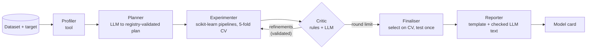

# Autonomous Data-Science Agent

Give it a dataset and a target column. A team of agents then profiles the data, plans experiments, trains and cross-validates models, critiques the leaderboard, runs a refinement round, and writes a **model card**. The language model never writes or executes code: it chooses from a validated registry of components.

Notebook: [`autonomous_data_science_agent.ipynb`](autonomous_data_science_agent.ipynb), fully executed.

## Objectives

- Automate a disciplined modelling workflow, with profiling, leakage checks, preprocessing inside CV folds and honest model selection, in an auditable way.
- Show a safe alternative to "code-interpreter" agents: the LLM makes *decisions*, and code *executes* them.
- Never let generated text misstate a result.

## Architecture



| Agent | Type | Responsibility |
|---|---|---|
| Profiler | Tool | Numeric and categorical columns, missing values, class balance, ID-like and leakage-suspect columns |
| Planner | LLM, Pydantic output | Metric, imputation, scaling and 3–4 candidate models with hyperparameters, from a JSON registry |
| Plan validator | Code | Drops unknown models, clamps hyperparameters to the allowed grids and fully specifies every configuration, so duplicates are detectable |
| Experimenter | Tool | Builds `ColumnTransformer` + model pipelines and runs stratified 5-fold CV on the training split; failures are recorded, not fatal |
| Critic | Rules + LLM | Rules flag failed runs and train–CV gaps > 0.10. The LLM proposes refinements, which are validated. An assessment that quotes numbers not on the leaderboard is replaced by a factual summary. |
| Finaliser | Code | Selects on CV only (ties broken deterministically: lower CV std, then the simpler model), refits, and scores **once** on a held-out 20% test set, alongside an untuned linear model and a trivial baseline |
| Reporter | Template + LLM | Code writes every comparison and number; the LLM adds one qualitative limitation, which is rejected if it contains any digit |

## Datasets

| Dataset | Task | Licence |
|---|---|---|
| [Palmer Penguins](https://allisonhorst.github.io/palmerpenguins/) (Horst, Hill & Gorman 2020), via the [seaborn-data](https://github.com/mwaskom/seaborn-data) mirror | 3-class species; missing values; categorical features | CC0 1.0 |
| [Breast Cancer Wisconsin (Diagnostic)](https://archive.ics.uci.edu/dataset/17/breast+cancer+wisconsin+diagnostic), bundled with scikit-learn | binary diagnosis | CC BY 4.0 |
| [Diabetes](https://www4.stat.ncsu.edu/~boos/var.select/diabetes.html) (Efron et al. 2004), bundled with scikit-learn | regression of disease progression | distributed with scikit-learn (BSD-3-Clause) |

A copy of the Palmer Penguins data (CC0) is in [`sample_data/`](sample_data/), with attribution.

## Results (from the committed run)

A copy of the Palmer Penguins data (CC0) is in [`sample_data/`](sample_data/), with attribution.

All LLM calls were live (Qwen3-1.7B, offline; 9 calls, 0 from cache).

| Dataset | Metric (chosen by planner) | Planner's preprocessing | Selected model | CV score | Test: agent | Test: untuned linear | Test: trivial |
|---|---|---|---|---:|---:|---:|---:|
| Penguins | accuracy | mean imputation, no scaling | logistic regression, C = 1 | 0.9964 | 1.0000 | 1.0000 | 0.4348 |
| Breast cancer | balanced accuracy | median imputation, **no scaling** | hist. gradient boosting (lr 0.05, depth 4) | 0.9642 | **0.9573** | **0.9812** | 0.5000 |
| Diabetes | −RMSE | mean imputation, no scaling | RBF SVR, C = 50 | −58.22 | **−50.08** | −53.78 | −73.22 |

- **Mixed, honestly reported outcome.**
  - On **diabetes**, the critic's refinement found a model that beats the untuned ridge baseline on the held-out test set (RMSE 50.1 vs 53.8).
  - On **breast cancer**, the planner chose *not to scale features*, which handicaps linear models and SVMs inside the search. The agent ended **below** an untuned, scaled logistic regression (0.957 vs 0.981). The baseline exists precisely to expose this kind of planning error, and a natural next step is a rule-based critic check: "scale=False with distance- or penalty-based models".
  - Penguins is close to perfectly separable.
- **Planner reliability:** valid, registry-conformant plans for 3 of 3 datasets with Qwen3-1.7B. The earlier Qwen2.5-1.5B produced 2 of 3, and the validator would fill defaults on failure.
- **Critic:** its refinements were valid on all three datasets, and on two of them they improved the cross-validated best model.
- **Guardrails seen across development runs:**
  - The JSON registry fixed parse failures caused by the model copying Python `None`.
  - An SVM failure under multiclass ROC AUC was recorded and flagged instead of crashing.
  - An LLM-written interpretation once misstated which score was higher. That is why comparisons are now written by code.

## Real-world applications

- AutoML-style baselining for analytics teams, with a human-readable audit trail.
- Model-risk documentation: every model card states its selection protocol, baselines and limitations.
- A safe pattern for LLM agents in regulated environments: no generated code is executed.

## Limitations

- Small search space and grids; no feature engineering, no Bayesian optimisation.
- Penguins is close to perfectly separable, so a ROC AUC of 1.0 leaves no room to discriminate between models.
- Planning quality depends on the backend: the 1.7B offline model makes plausible-looking but suboptimal choices (such as no scaling), which the selection protocol cannot correct because it only compares the candidates the plan contains.

## Future improvements

- An Optuna-backed search inside the experimenter tool, with the budget set by the planner.
- SHAP explanations and fairness checks in the model card.
- Repeated or nested cross-validation for more stable selection on small data.

## Running it

```bash
pip install -r requirements.txt
cp .env.example .env          # optional: add an OpenAI or Gemini key, or run Ollama; offline works with no keys
jupyter nbconvert --to notebook --execute --inplace autonomous_data_science_agent.ipynb
```

The notebook takes about 4 minutes on CPU with the local model. Every LLM call is logged in `outputs/llm_calls.jsonl`, and the last cell prints a provenance report. `outputs/leaderboards.html` is an interactive plot of score against fit time.

## Models

| Model | Licence |
|---|---|
| [Qwen3-1.7B](https://huggingface.co/Qwen/Qwen3-1.7B), the offline default on 8 GB machines (larger Qwen3 models are chosen automatically on bigger hardware) | Apache-2.0 |

## Technologies

LangGraph · [agentkit](../agentkit/) (OpenAI · Gemini · Ollama · Hugging Face) · LangChain · Hugging Face Transformers · scikit-learn · Pydantic · pandas · matplotlib · Plotly · NetworkX

## References

- Horst, A. M., Hill, A. P. & Gorman, K. B. (2020). palmerpenguins: Palmer Archipelago (Antarctica) penguin data. R package. doi:10.5281/zenodo.3960218
- Street, W. N., Wolberg, W. H. & Mangasarian, O. L. (1993). Nuclear feature extraction for breast tumor diagnosis. *SPIE*.
- Efron, B., Hastie, T., Johnstone, I. & Tibshirani, R. (2004). Least angle regression. *Annals of Statistics*, 32(2).
- Mitchell, M. et al. (2019). Model cards for model reporting. *FAT\* '19*.
