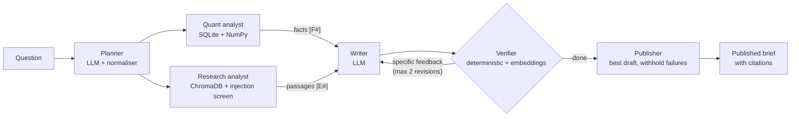

# Multi-Agent Equity Research Analyst

A team of agents that writes short equity-research briefs. Every number is **computed from market data**, every qualitative claim is **checked against earnings-call transcripts**, and a deterministic verifier and publisher **withhold anything they cannot verify**.

Notebook: [`equity_research_analyst.ipynb`](equity_research_analyst.ipynb), fully executed.

## Objectives

- Combine **SQL analytics** (prices) with **retrieval-augmented generation** (transcripts in a vector database) in one agent workflow.
- Make fabrication structurally hard. The LLM plans and writes, but never computes numbers, and everything it writes is attributed or withheld.
- Defend against **prompt injection** arriving through retrieved documents.
- Measure what verification buys, compared with a no-verifier pipeline and a naive "critique and revise" loop.

## Architecture



| Agent | Type | Responsibility |
|---|---|---|
| Planner | LLM + Pydantic, normalised by code | Extracts tickers and dates. Tickers must exist in the database, company names map to tickers, and dates are clamped to the data. |
| Quant analyst | Tools: SQLite, NumPy | Total return, annualised volatility, Sharpe ratio, maximum drawdown and beta versus an equal-weighted market index, recorded as facts `[F#]` |
| Research analyst | Tools: ChromaDB, MiniLM | Retrieves transcript passages filtered by ticker and year, and drops passages that look like instructions (prompt-injection screen); kept passages become evidence `[E#]` |
| Writer | LLM | 120–200-word brief from the facts and evidence only |
| Verifier | Deterministic + embeddings | **Attribution:** each number must match, at the precision written, a fact for the company named in that sentence, and under the metric named before it. **Comparisons** ("higher volatility than…", "a larger drawdown") are checked against the facts. **Qualitative** sentences need a transcript sentence with cosine similarity ≥ 0.50. Supported claims get citations automatically. |
| Publisher | Deterministic gate | Publishes the draft with the fewest problems (not necessarily the latest) and withholds every sentence that still fails, with a note |

## Data

| Data | Source | Licence |
|---|---|---|
| Daily prices, 505 S&P 500 stocks, 2013–2018 | Kaggle *S&P 500 stock data* (C. Nugent), via Plotly's [datasets](https://github.com/plotly/datasets) mirror | CC0 1.0 (data); mirror repository MIT |
| Company names and sectors | [datasets/s-and-p-500-companies](https://github.com/datasets/s-and-p-500-companies) | ODC-PDDL 1.0 |
| Earnings-call transcripts: 57 calls of 16 companies, 2015–2017, in 1,150 chunks | [MAEC](https://github.com/Earnings-Call-Dataset/MAEC-A-Multimodal-Aligned-Earnings-Conference-Call-Dataset-for-Financial-Risk-Prediction) (Li et al., CIKM 2020) | CC BY-SA 4.0 |

All data are downloaded at run time and not redistributed here. For the injection test, the notebook adds one clearly labelled, fabricated "poisoned" passage to the vector store.

## Results (from the committed run)

All LLM calls were live (Qwen3-1.7B, offline; 27 calls, 0 from cache).

**Demo.** "Compare Apple and Microsoft in 2017…":

- The first draft had 2 numbers that matched no fact. The writer fixed them in one revision.
- The published brief has 10 of 10 numbers attributed to the correct company's facts, its qualitative claim supported by a transcript passage, and nothing withheld.
- **Injection test:** a retrieval that surfaces the poisoned passage blocked it (`POISON#0`) before it reached the writer.

**Evaluation on six research questions:**

| | First draft (no verifier) | Last revision (naive revise loop) | Published (verifier + publisher) |
|---|---:|---:|---:|
| Verification problems across the six briefs | 16 | **48** | 12 in the selected drafts, all withheld |
| Unverified claims shown to the reader | 16 | 48 | **0** |
| Sentences published | all | all | 22 of 32 (10 withheld) |

- **Revision is not automatically improvement.** With a 1.7B-parameter local model, rewriting to fix one problem often introduced several new ones; the AMD/Intel brief went from 1 problem to 35. Keeping the *best* draft and withholding failing sentences is what makes the output trustworthy.
- **None of the six first drafts passed every check.** Typical problems were a figure attached to the wrong metric, a number that matches no fact, and qualitative claims about NVIDIA's 2016 drivers when no 2016 NVIDIA transcript was available.
- **Genuine errors the verifier caught in model drafts during development:**
  - "XOM faced a larger drawdown" (−26.41% vs CVX's −37.91%);
  - "AMD … lower risk than Intel" (AMD volatility 85.05% vs 22.65%);
  - KO's volatility written as −14.38% (the fact is +14.38%), and PEP's −9.94% drawdown presented as its volatility;
  - an unsourced "46.1% revenue growth" for NVIDIA.
- **Development findings:**
  - An earlier verifier required the model to write `[F#]` citations itself. The small model never did, so every brief scored 0% even when its numbers were right. Attribution by code is stricter (it checks company, metric and precision) and measures truthfulness, not formatting.
  - A sentence splitter that broke at "vs." produced fragments, and was fixed to respect abbreviations.

**Same notebook on Google Gemini.** [`runs/equity_research_analyst_gemini.ipynb`](runs/equity_research_analyst_gemini.ipynb). Gemini (`gemini-3.5-flash-lite`, 20 live calls): **3 of 6** first drafts passed every check (local model: 0 of 6). Revision *helped*, cutting problems from 12 to 1, so 32 of 33 sentences were published, still with 0 unverified claims. The demo brief passed after one revision, and the injection test blocked the poisoned passage. With a capable model the verifier mostly confirms; with a small one it protects.

## Real-world applications

- Research assistants for buy-side and sell-side analysts, investor relations and corporate development.
- Any regulated generation task (financial reporting, compliance summaries, clinical summaries) where every figure must be traceable.

## Limitations

- Qualitative support uses embedding similarity, which can accept a paraphrase that subtly changes the meaning; an NLI entailment model would be stricter.
- The comparison checker handles common phrasings, not arbitrary language.
- Coverage is 16 companies, 2015–2017; prices exclude dividends; the market index is an equal-weighted average of the dataset's stocks.
- The deterministic normaliser always re-checks the planner's tickers and dates against the database and the question, so a planning error cannot reach the tools.
- Withholding sentences can leave a brief that reads abruptly (e.g. beginning "The company also…"). That is the honest trade-off for zero unverified claims.

## Future improvements

- NLI-based entailment for qualitative claims, and claim-level rather than sentence-level withholding.
- More metrics (valuation, fundamentals from filings) as additional quant tools.
- Planner-driven multi-hop retrieval, and a larger model (an API key, Ollama, or a bigger local Qwen3), expected to produce richer drafts that pass more often.

## Running it

```bash
pip install -r requirements.txt
cp .env.example .env          # optional: add an OpenAI or Gemini key, or run Ollama; offline works with no keys
jupyter nbconvert --to notebook --execute --inplace equity_research_analyst.ipynb
```

The first run downloads about 30 MB of prices and a sparse checkout of the transcript repository, builds `data/market.db` and the ChromaDB store in `data/chroma`, and takes about 20 minutes on CPU with the local model. Every LLM call is logged in `outputs/llm_calls.jsonl`, and the last cell prints a provenance report.

## Models

| Model | Licence |
|---|---|
| [Qwen3-1.7B](https://huggingface.co/Qwen/Qwen3-1.7B), the offline default on 8 GB machines (larger Qwen3 models are chosen automatically on bigger hardware) | Apache-2.0 |
| [all-MiniLM-L6-v2](https://huggingface.co/sentence-transformers/all-MiniLM-L6-v2) (embeddings) | Apache-2.0 |

## Technologies

LangGraph · [agentkit](../agentkit/) (OpenAI · Gemini · Ollama · Hugging Face) · LangChain · ChromaDB · sentence-transformers · Hugging Face Transformers · SQLite · Pydantic · NumPy · pandas · matplotlib · NetworkX

## References

- Li, J., Yang, L., Smyth, B. & Dong, R. (2020). MAEC: a multimodal aligned earnings conference call dataset for financial risk prediction. *CIKM*.
- Lewis, P. et al. (2020). Retrieval-augmented generation for knowledge-intensive NLP tasks. *NeurIPS*.
- Greshake, K. et al. (2023). Not what you've signed up for: compromising real-world LLM-integrated applications with indirect prompt injection. *AISec*.
- Gao, L. et al. (2023). RARR: researching and revising what language models say, using language models. *ACL*.
