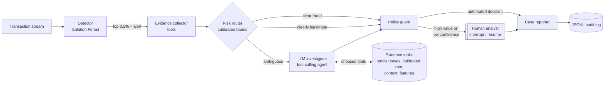

# Agentic Fraud Alert Triage with Human-in-the-Loop

An agent workflow that **investigates every fraud alert, decides what it safely can, and pauses for a human analyst on the rest**, recording a complete audit trail. The goal is to cut analyst workload without losing fraud catches.

Notebook: [`fraud_alert_triage_hitl.ipynb`](fraud_alert_triage_hitl.ipynb), fully executed.

## Objectives

- Turn raw anomaly alerts into decisions (`escalate` / `dismiss`) backed by evidence.
- Use the language model only where the evidence is ambiguous, as a genuine tool-using investigator, and never let it make a high-stakes call alone.
- Demonstrate a real **pause-and-resume** human-in-the-loop step with LangGraph `interrupt`, and measure workload, catch rate and precision against honest baselines.

## Architecture



| Agent / node | Type | Responsibility |
|---|---|---|
| Detector | Isolation Forest | Scores transactions; the threshold is fixed on historical data |
| Evidence collector | Tools | Anomaly percentile, the most unusual features (z-scores), the outcomes of the 25 most similar *historical* labelled cases, amount, hour |
| Risk router | Rules | Bands calibrated on historical alerts: auto-dismiss only where the past fraud rate was ≤ 0.5%, auto-escalate only where every evidence level had a fraud rate ≥ 50%, and send the middle band to the LLM |
| LLM investigator | **Tool-calling agent** | Receives only the alert ID and **decides which evidence tools to call**: `get_similar_cases`, `get_calibrated_fraud_rate`, `get_transaction_context`, `get_feature_deviations`. Then it returns a Pydantic-validated decision, confidence and rationale. |
| Policy guard | Hard rules | No automated dismissal above €500. A human also gets any LLM decision that has confidence below 0.6, was made without the similar-case tools, or **contradicts the evidence the agent itself retrieved** (for example, escalating when the calibrated fraud rate it fetched is below 50%). |
| Human analyst | LangGraph `interrupt` | The graph pauses with a case packet and resumes with the analyst's decision. **Simulated here with the true labels.** |
| Case reporter | Template | Writes a case note and appends a JSON line to the audit log for every alert |

## Data

| Dataset | Source | Licence |
|---|---|---|
| Credit-card fraud, Sept 2013 (284,807 transactions, 492 frauds; PCA-anonymised, no personal information) | Machine Learning Group, ULB / Worldline, via a [public GitHub mirror](https://github.com/stat432/credit-analysis); SHA-256-verified at download | [ODbL 1.0](https://opendatacommons.org/licenses/odbl/1-0/) (database), [DbCL 1.0](https://opendatacommons.org/licenses/dbcl/1-0/) (contents) |

The data are downloaded at run time and not redistributed here. Splits follow time: the first 60% of transactions is history (detector training, case library and threshold calibration), and the last 40% is the live period being evaluated.

## Results (from the committed run)

The detector raised **530 alerts** in the live period, of which 35 were fraud (6.6% precision). All 530 went through the triage graph. All LLM calls were live (Qwen3-1.7B, offline; 23 calls, 0 from cache).

| Policy | Frauds caught (of 35 alerted) | False escalations | Precision of escalations | Human reviews | Workload vs review-all |
|---|---:|---:|---:|---:|---:|
| Analyst reviews every alert | 35 | 0 | 100% | 530 | 100% |
| Auto-escalate every alert | 35 | 495 | 6.6% | 0 | 0% |
| **Agentic triage** | **35** | **1** | **97.2%** | **178** | **34%** |

- **Routing:** 491 alerts were auto-dismiss candidates, 36 auto-escalated and 3 investigated by the LLM agent. 175 of the would-be dismissals exceeded €500, so policy sent them to a human.
- **Genuine tool use:**
  - In all 3 investigations the agent chose to call `get_similar_cases`, passed the count it received into `get_calibrated_fraud_rate`, and then fetched context and feature deviations.
  - A repeated identical call was not re-executed, and the agent was told it already had that result.
  - The notebook prints one full tool-calling trace.
- **The LLM's judgement was wrong, and the guard caught it:**
  - In all 3 cases the agent retrieved a calibrated fraud rate of 20%, then proposed *escalate* at 0.75 confidence, despite an explicit "more likely than not" policy. All three were legitimate.
  - The policy guard detected that each decision contradicted the agent's own evidence and sent them to a human. As a result, the 97.2% precision is unaffected.
  - This is the project's central design point: the model gathers and summarises; code checks its conclusions.
- **Rules:** 351 of 352 automated decisions were correct.
- **Detector ceiling:** 97 live frauds were never alerted. Triage cannot recover what the detector misses.
- **Development history:** an earlier version gave the LLM a pre-assembled evidence packet. Moving to tool calling, and checking the decision against the retrieved evidence, made the agent's behaviour inspectable, and made its errors safe.

**Same notebook on Google Gemini.** [`runs/fraud_alert_triage_hitl_gemini.ipynb`](runs/fraud_alert_triage_hitl_gemini.ipynb). Gemini (`gemini-3.5-flash-lite`, 15 live calls): the investigator called `get_similar_cases` → `get_calibrated_fraud_rate` → `get_transaction_context` and then stopped to answer, without looping. Its proposals were **3 of 3 correct** (dismiss at a 20% fraud rate; local model: 0 of 3). The triage outcome is the same (35/35 frauds, 97.2% precision, 34% workload), because policy still requires human sign-off for dismissals above €500.

## Real-world applications

- Card and payment fraud operations: alert queues, case management and analyst productivity.
- AML transaction monitoring, insurance-claims triage, and security-alert (SOC) triage. These share the same "too many alerts, few true positives" structure and need audit trails.

## Limitations

- The **human analyst is simulated** with the true labels, which assumes a perfect reviewer. Real human accuracy is lower, so the human rows are an upper bound.
- Two days of 2013 data; thresholds are calibrated on one historical window, with no drift handling.
- The ambiguous band is small on this dataset, so the LLM investigates only 3 cases. That is by design, but it means the LLM's measured accuracy (0 of 3 with the 1.7B offline model) rests on very few cases. A larger model (an API key, Ollama, or a bigger local Qwen3 on more memory) is expected to follow the decision policy better; the guard makes that a quality issue, not a safety issue.
- PCA-anonymised features limit how interpretable the evidence is to a human.

## Future improvements

- Analyst feedback loop: human decisions retrain the case library and recalibrate the bands.
- A cost-sensitive optimisation of the routing bands, using the fraud team's cost of a miss versus the cost of a review.
- Integration with a case-management queue, and SLA-aware prioritisation of the paused threads.

## Running it

```bash
pip install -r requirements.txt
cp .env.example .env          # optional: add an OpenAI or Gemini key, or run Ollama; offline works with no keys
jupyter nbconvert --to notebook --execute --inplace fraud_alert_triage_hitl.ipynb
```

The whole notebook runs in about 4 minutes on CPU. Outputs include `outputs/audit_log.jsonl` (one record per alert, including the investigator's tool calls), `outputs/llm_calls.jsonl` (one record per LLM call) and `outputs/alerts.html` (interactive evidence plot).

## Models

| Model | Licence |
|---|---|
| [Qwen3-1.7B](https://huggingface.co/Qwen/Qwen3-1.7B), the offline default on 8 GB machines (larger Qwen3 models are chosen automatically on bigger hardware) | Apache-2.0 |

## Technologies

LangGraph (StateGraph, `interrupt`, `Command`, MemorySaver checkpointer) · [agentkit](../agentkit/) (OpenAI · Gemini · Ollama · Hugging Face; native tool calling) · Hugging Face Transformers · scikit-learn · Pydantic · pandas · matplotlib · Plotly

## References

- Dal Pozzolo, A., Caelen, O., Johnson, R. A. & Bontempi, G. (2015). Calibrating probability with undersampling for unbalanced classification. *IEEE SSCI*.
- Liu, F. T., Ting, K. M. & Zhou, Z.-H. (2008). Isolation forest. *IEEE ICDM*.
- LangGraph documentation: human-in-the-loop with `interrupt`.
