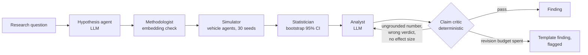

# Multi-Agent Intersection Coordination Lab

A simulation of a **tragedy of the commons** among autonomous vehicles at an unsignalised intersection, plus a **LangGraph research team** that forms hypotheses, runs experiments and reports statistically checked findings.

Notebook: [`intersection_coordination_lab.ipynb`](intersection_coordination_lab.ipynb), fully executed.

## Objectives

- Model vehicles as agents that either **cooperate** with an intersection manager or **defect** and act selfishly, and measure what each choice costs the individual and the group.
- Compare two coordination protocols: **FCFS reservation** and a **value-of-time auction**.
- Automate the research loop with agents while keeping every reported number traceable to the simulator's output.

## Architecture



| Agent | Type | Role |
|---|---|---|
| Vehicle agents | Simulation | Cooperators follow the manager's grant. Defectors enter whenever the box looks clear to them, and misjudge gaps with probability 0.10. |
| Intersection manager | Simulation | Grants the box to one axis: FCFS (oldest cooperator first) or an auction (highest total bid, where bid = value of time × waiting time) |
| Hypothesis agent | LLM, validated output | States a hypothesis, picks an experiment from a fixed registry and predicts the sign of its effect |
| Methodologist | Embeddings (MiniLM) | Checks that the chosen experiment actually addresses the question; overrides clear mismatches and records the override |
| Statistician | Deterministic | Means and bootstrap confidence intervals over 30 seeds, paired by seed where possible |
| Analyst | LLM | Writes the finding |
| Claim critic | Deterministic | Rejects numbers the statistician did not produce, verdicts that contradict the confidence interval, and findings that omit the effect size |

## Simulation design

- One step is one second, and each run lasts one hour. Arrivals are Bernoulli with probability 0.09 per second on each of four approaches, and a crossing takes 2 s.
- North–south and east–west traffic conflict. When vehicles on conflicting axes enter together, the intersection is blocked for 8 s (a **conflict**).
- Defectors decide in the same second as the manager and cannot see its grants, which is what makes defection costly to others.
- Each design runs 30 random seeds. Delay counts from arrival to entering the box, after a 2-minute warm-up.

[`sample_data/simulation_results.csv`](sample_data/simulation_results.csv) contains the metrics for all 660 simulation runs behind these results.

## Results (from the committed run)

**The commons dilemma.** FCFS manager, mean over 30 seeds:

| Cooperators | Mean delay (s) | Cooperator delay (s) | Defector delay (s) | Conflicts / hour | Completion |
|---:|---:|---:|---:|---:|---:|
| 0% | 503.85 | – | 503.85 | 390.0 | 73% |
| 30% | 37.72 | 40.63 | 36.49 | 269.7 | 99% |
| 50% | 9.06 | 9.82 | 8.30 | 163.3 | 100% |
| 70% | 3.22 | 3.45 | 2.70 | 86.4 | 100% |
| 100% | 0.60 | 0.60 | – | 0.0 | 100% |

At every mixed participation level, **defectors wait less than cooperators**, so defection is individually rational. But every additional defector adds conflicts, and with no cooperators the intersection gridlocks: delay is about 840 times higher and 27% of vehicles never get through within the hour. This is the classic social-dilemma structure.

**Research-agent findings.** Δ is the primary effect of each experiment, with a 95% bootstrap CI:

| Question | Experiment chosen | Predicted | Δ (95% CI) | Supported | Finding written by |
|---|---|---|---|---|---|
| Q1: delay vs cooperator share | participation sweep | negative | −503.26 s (−526.83, −481.46) | yes | LLM analyst (passed critic on draft 1) |
| Q2: does defecting pay at 50%? | individual incentive | negative | −1.53 s (−1.74, −1.32) | yes | template (the critic rejected 3 drafts) |
| Q3: auction vs FCFS at 100% | protocol comparison | negative | −0.11 s (−0.12, −0.10) | yes | template (the critic rejected 3 drafts) |

- The methodologist approved all three experiment choices. In an earlier run *without* the methodologist, the hypothesis agent picked the protocol experiment for the participation question, which is why that step exists.
- For Q2, the local model's drafts claimed that defecting **increases** delay, the opposite of the data. The critic rejected them, so a wrong claim never reached the report.
- **Protocol nuance:** the auction lowers value-weighted delay under full cooperation (0.49 s vs 0.60 s), but at 50% cooperators it is *worse* than FCFS (10.93 s vs 9.13 s). Batching high-value vehicles gives defectors more chances to collide.

## Real-world applications

- Connected and automated vehicle coordination: intersection managers and platooning.
- Mechanism design for shared infrastructure, such as charging stations, airspace slots and network bandwidth.
- Agentic research assistants for simulation studies, where claims must be tied to experimental output.

## Limitations

- A stylised single intersection with no turning movements, vehicle dynamics or learning, and a fixed defection rule. The results illustrate mechanisms; they are not calibrated traffic predictions.
- Results depend on the demand level, the conflict penalty and the misjudgement rate.
- The research agenda is three predefined questions, and the hypothesis agent chooses among registered experiments only. It cannot design new ones.
- With the 1.5B-parameter offline model, the analyst often fails to write a compliant finding; a larger model (via `OPENAI_API_KEY`) is expected to pass the critic more often.

## Future improvements

- Agents that **learn** whether to defect (evolutionary dynamics or multi-agent RL), to study how cooperation emerges or collapses.
- Payments in the auction, to study incentive compatibility; road networks with several intersections.
- Let the hypothesis agent propose parameter sweeps within validated bounds.

## Running it

```bash
pip install -r requirements.txt
cp .env.example .env          # optional: add OPENAI_API_KEY to use gpt-4o-mini instead of the local model
jupyter nbconvert --to notebook --execute --inplace intersection_coordination_lab.ipynb
```

The simulations take about 15 seconds. LLM calls are cached in `outputs/llm_cache.json`; a first run with the local model needs a few minutes on CPU. Outputs include `outputs/participation_sweep.html` (interactive) and `outputs/simulation_results.csv`.

## Data and models

| Item | Source | Licence |
|---|---|---|
| Simulation data | Generated by the notebook (synthetic, seeded) | – |
| Qwen2.5-1.5B-Instruct (offline LLM) | [Hugging Face](https://huggingface.co/Qwen/Qwen2.5-1.5B-Instruct) | Apache-2.0 |
| all-MiniLM-L6-v2 (methodologist embeddings) | [Hugging Face](https://huggingface.co/sentence-transformers/all-MiniLM-L6-v2) | Apache-2.0 |

No personal or proprietary data are used.

## Technologies

LangGraph · LangChain (OpenAI backend) · Hugging Face Transformers · sentence-transformers · Pydantic · NumPy · pandas · matplotlib · Plotly · NetworkX

## References

- Hardin, G. (1968). The tragedy of the commons. *Science*, 162(3859).
- Dresner, K. & Stone, P. (2008). A multiagent approach to autonomous intersection management. *Journal of Artificial Intelligence Research*, 31.
- Carlino, D., Boyles, S. & Stone, P. (2013). Auction-based autonomous intersection management. *IEEE ITSC*.
- Efron, B. & Tibshirani, R. (1993). *An Introduction to the Bootstrap*. Chapman & Hall.
