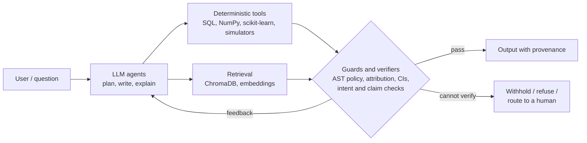

# Agentic AI

Five multi-agent systems built with **LangGraph**. Each one pairs language-model agents with deterministic tools, guards and verifiers. The shared design principle: **the LLM proposes, code verifies.** Every project has a fully executed Jupyter notebook, a README with architecture, results and limitations, a `requirements.txt` and a `.env.example`. Each runs **offline on CPU** with an open-weight model, or on the OpenAI API when a key is provided.

| Project | What the agents do | Key techniques | Headline result (committed run) |
|---|---|---|---|
| [Multi-Agent Equity Research Analyst](Equity-Research-Analyst/) | Plan → compute market metrics → retrieve earnings-call evidence → write → verify → publish | SQL tools, **ChromaDB** RAG, prompt-injection screen, claim attribution, comparison checking, verification-gated publishing | Naive revise loop: 25 verification problems; verifier + publisher: **0 unverified claims** shown (26/33 sentences published). Injected passage blocked. |
| [Self-Correcting Text-to-SQL BI Agent](Text-to-SQL-BI-Agent/) | Retrieve schema → write SQL → guard → check intent → diagnose and repair → explain | Embedding schema retrieval, **sqlglot AST guard**, read-only SQLite, intent checker, error diagnostician | 14/24 vs 13/24 single-shot; **silent errors 5 vs 7**; red-team **6/6** blocked |
| [Agentic Fraud Alert Triage with HITL](Fraud-Alert-Triage-HITL/) | Detect → gather evidence → route → LLM investigates ambiguous cases → policy guard → **human interrupt** → audit | Isolation Forest, case-based retrieval, calibrated routing, LangGraph `interrupt` / `Command(resume)`, JSONL audit log | All **35/35** alerted frauds kept, escalation precision **97.2%**, analyst workload **34%** of review-all |
| [Autonomous Data-Science Agent](Autonomous-Data-Science-Agent/) | Profile → plan → cross-validate → critique → refine → model card | Registry-constrained planning (no generated code is executed), CV-only selection, grounded critic, code-written model cards | Matches strong tuned-linear baselines on 3 public datasets without overfitting CV noise; every model-card statement is code-verified |
| [Multi-Agent Intersection Coordination Lab](Intersection-Coordination-Lab/) | Vehicle agents (cooperate / defect, FCFS / auction) + a research team: hypothesis → methodologist → simulate → statistics → analyst → critic | Agent-based simulation, bootstrap CIs over 30 seeds, embedding methodologist, deterministic claim critic | Tragedy of the commons: defectors always wait less, yet delay rises from **0.6 s to 504 s** as cooperation collapses; 3/3 hypotheses tested with correct experiments |

## Shared architecture



**Common patterns across the five projects**

- **Dual LLM backend.** A shared `LLM` class uses `gpt-4o-mini` through LangChain when `OPENAI_API_KEY` is set, and otherwise **Qwen2.5-1.5B-Instruct** locally through Hugging Face Transformers. Calls are cached on disk (`outputs/llm_cache.json`), and structured outputs are validated with Pydantic, with retries.
- **Numbers come from code, never from the model.** Every figure in a report is produced by a tool and checked by a verifier before it is shown.
- **Fail closed.** When verification fails, the system withholds the sentence (equity), says it cannot answer (Text-to-SQL), routes to a human (fraud), or publishes a flagged template (intersection lab).
- **Security.** Read-only database connections, AST-level SQL policy, prompt-injection screening of retrieved text, red-team tests, no generated code executed, and secrets only via `.env` (never committed).
- **Logging and observability.** Every notebook writes `outputs/run.log`; agent traces are printed step by step; the fraud project keeps a JSONL audit log.
- **Interactive visualisations.** Plotly HTML exports in `outputs/`, plus LangGraph topology diagrams drawn from the compiled graphs.

## Testing and execution status

Every notebook was executed top to bottom with `jupyter nbconvert --execute` on CPU (2 cores, no GPU) using the offline Qwen2.5-1.5B model:

| Notebook | Code cells | Executed in order | Errors | LLM calls in final run |
|---|---:|:---:|---:|---|
| `equity_research_analyst.ipynb` | 18 | ✓ | 0 | 36 |
| `text_to_sql_bi_agent.ipynb` | 15 | ✓ | 0 | 92 |
| `fraud_alert_triage_hitl.ipynb` | 14 | ✓ | 0 | 3 |
| `autonomous_data_science_agent.ipynb` | 14 | ✓ | 0 | 11 |
| `intersection_coordination_lab.ipynb` | 12 | ✓ | 0 | 10 |

Each notebook's last cell prints its backend and how many LLM responses came from the cache. In the final runs most responses were served from the cache, because prompts were unchanged from earlier runs in which the model generated them. Deleting `outputs/llm_cache.json` forces fresh generation (about 20–30 minutes each for the equity and Text-to-SQL notebooks on CPU, and a few minutes for the others). The OpenAI path is implemented, but it was **not** exercised here because no API key was available.

Each notebook also contains its own tests: guard and red-team cases (Text-to-SQL), a planted prompt injection (equity), gold-question evaluation with a single-shot baseline (Text-to-SQL), baselines and held-out test sets (data science), review-all and auto-escalate baselines (fraud), and seeded bootstrap statistics (intersection lab).

## Getting started

```bash
cd "Agentic AI/<project folder>"
python -m venv .venv && source .venv/bin/activate
pip install -r requirements.txt
cp .env.example .env               # optional: OPENAI_API_KEY=... to use the OpenAI API
jupyter lab                        # open the notebook and run all cells
```

Python 3.11+ is recommended. The first run downloads the open-weight model (about 3 GB) and each project's public dataset.

## Data, licences and ethics

Only public, openly licensed or synthetic data are used, and no personal or confidential information:

- **Equity research:** S&P 500 prices (CC0), constituent list (ODC-PDDL), MAEC transcripts (CC BY-SA 4.0).
- **Text-to-SQL:** synthetic pharmaceutical database generated in the notebook.
- **Fraud triage:** ULB credit-card fraud data (ODbL / DbCL), PCA-anonymised.
- **Data-science agent:** Palmer Penguins (CC0), Breast Cancer Wisconsin (CC BY 4.0), and the scikit-learn Diabetes dataset.
- **Intersection lab:** synthetic simulation output.

Models: Qwen2.5-1.5B-Instruct and all-MiniLM-L6-v2 (both Apache-2.0). Datasets and model weights are downloaded at run time and not redistributed here. Each project README lists sources and licences in full.

Simulated components are labelled as such. Notably, the fraud project's human analyst is simulated with ground-truth labels.

## Honest limitations

- A 1.5B-parameter local model was used so that everything runs without credentials. Its planning and writing are weak; the verifiers, guards and fallbacks are what keep outputs correct. Results with an API model are expected to be better, but were not measured here.
- Evaluation sets are small (24 SQL questions, 6 research briefs, 3 datasets, 3 research questions), so differences between systems carry wide uncertainty.
- Each project README lists its own limitations and future improvements.
