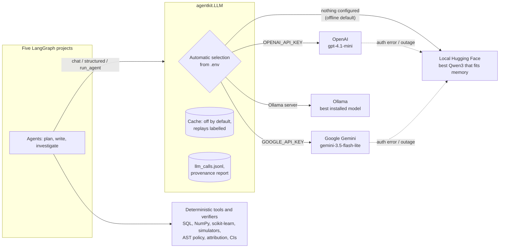

# Agentic AI

Five multi-agent systems built with **LangGraph** on a shared, **provider-independent LLM layer** ([`agentkit`](agentkit/)). Each pairs language-model agents with deterministic tools, guards and verifiers. The shared design principle: **the LLM proposes, code verifies.**

Every project has a fully executed Jupyter notebook, a README (architecture, results, limitations, licences), a `requirements.txt` and a `.env.example`. All five run **fully offline on a CPU** with an open-weight model. They switch to **OpenAI, Google Gemini or Ollama** by adding a key or starting a server; no code changes are needed.

| Project | What the agents do | Key techniques | Headline result (committed live run) |
|---|---|---|---|
| [Multi-Agent Equity Research Analyst](Equity-Research-Analyst/) | Plan → compute market metrics → retrieve earnings-call evidence → write → verify → publish | SQL tools, **ChromaDB** RAG, prompt-injection screen, claim attribution, comparison checking, verification-gated publishing | Naive revise loop: 48 verification problems; verifier + publisher: **0 unverified claims** shown (22/32 sentences published). Injected passage blocked. |
| [Self-Correcting Text-to-SQL BI Agent](Text-to-SQL-BI-Agent/) | Rank schema → write SQL → guard → check intent → diagnose and repair → explain | Embedding schema retrieval with prompt budget, **sqlglot AST guard**, read-only SQLite, intent checker, error diagnostician | **17/24 vs 14/24** for single-shot on the offline model (24/24 vs 23/24 on Gemini); red-team **6/6** blocked |
| [Agentic Fraud Alert Triage with HITL](Fraud-Alert-Triage-HITL/) | Detect → gather evidence → route → **tool-calling LLM investigator** → policy guard → **human interrupt** → audit | Isolation Forest, case-based retrieval, calibrated routing, native tool calling, evidence-consistency guard, LangGraph `interrupt` | All **35/35** alerted frauds kept, escalation precision **97.2%**, analyst workload **34%** of review-all. The LLM's 3 wrong proposals were all caught by the guard. |
| [Autonomous Data-Science Agent](Autonomous-Data-Science-Agent/) | Profile → plan → cross-validate → critique → refine → model card | Registry-constrained planning (no generated code is executed), CV-only selection, grounded critic, code-written model cards | Beats the tuned-linear baseline on diabetes (RMSE 50.1 vs 53.8); **below** it on breast cancer, where the planner skipped feature scaling. Reported as is. |
| [Multi-Agent Intersection Coordination Lab](Intersection-Coordination-Lab/) | Vehicle agents (cooperate / defect, FCFS / auction) + a research team: hypothesis → methodologist → simulate → statistics → analyst → critic | Agent-based simulation, bootstrap CIs over 30 seeds, embedding methodologist, deterministic claim critic | Tragedy of the commons: defectors always wait less, yet delay rises from **0.6 s to 504 s** as cooperation collapses. The critic blocked a finding with the wrong direction. |

## Provider-independent architecture



- **Automatic configuration.** The provider is chosen in this order: OpenAI key → Gemini key → running Ollama server → local Hugging Face model. The local model is the best Apache-2.0 Qwen3 that fits in free memory: 8B, 4B, 1.7B or 0.6B. `LLM_PROVIDER` and `LLM_MODEL` override the choice. **Adding an OpenAI key later is a one-line `.env` change.**
- **OpenAI is optional.** Provider SDKs are imported lazily, and the default install needs none of them.
- **Structured outputs.** Pydantic validation with error-feedback repair; native JSON mode on OpenAI, Gemini and Ollama.
- **Tool calling.** Native on every provider. Local models use their chat template's tool format, and `run_agent()` runs a real loop: the model chooses tools and arguments, tools execute locally, and results go back. Bad calls are returned to the model as errors, and repeated calls are not re-run.
- **Error handling.** Retries with exponential backoff on transient errors. Authentication failures, missing SDKs or outages fall back to the local model; the fallback is logged as `[FALLBACK]` and recorded in provenance. Agents keep working offline.
- **Transparency.** Caching is **off by default**, so every committed result was generated live. If caching is enabled, every replayed response is flagged `[CACHE REPLAY]`, tagged in `outputs/llm_calls.jsonl` and counted separately. Every notebook ends with a provenance report: provider, model and revision, live vs cached calls, tokens, latency, estimated cost. Secrets are never printed.
- **Reproducibility and cost.** Temperature 0, greedy local decoding, fixed seeds, recorded model revisions; cheap default API models, per-call token and cost accounting, and $0 offline.

Configuration: copy [`.env.example`](.env.example) to `Agentic AI/.env` (shared by all projects). Details are in [`agentkit/README.md`](agentkit/README.md).

## Offline model vs Google Gemini

Every project was executed twice with **no code changes**: once offline, and once with a Gemini key in `.env`. Each project folder holds the offline run as its main notebook and the Gemini run in `runs/*_gemini.ipynb`. All calls in both runs were live.

| Project | Local Qwen3-1.7B (offline, CPU) | Gemini `gemini-3.5-flash-lite` |
|---|---|---|
| Equity research | 0/6 first drafts pass; revision made drafts worse (16 → 48 problems); 22/32 sentences published, all verified | 3/6 first drafts pass; revision helped (12 → 1); 32/33 sentences published, all verified |
| Text-to-SQL | agent 17/24 vs single-shot 14/24 | agent 24/24 vs single-shot 23/24 |
| Fraud triage | investigator proposals 0/3 correct, all caught by the evidence-consistency guard | proposals 3/3 correct; clean 3-tool investigations |
| Data-science agent | valid plans, but skipped scaling once (below baseline on breast cancer) | sensible plans; matches strong baselines on all three datasets |
| Intersection lab | 2/3 findings LLM-written (one blocked for a wrong direction); 1 hypothesis sign error | 3/3 findings pass the critic on the first draft; 3/3 hypotheses correct |

The same guards produce trustworthy output either way. With the small offline model they do most of the work; with a capable API model they mostly confirm.

## Testing and execution status

**Every notebook was executed top to bottom** with `jupyter nbconvert --execute`, with caching **off**, so every LLM response in the committed notebooks was generated live in that run. Offline runs used a CPU-only machine (2 cores, 8 GB RAM), where the selector chose **Qwen3-1.7B**. Gemini runs used a free-tier key with `LLM_MIN_INTERVAL=4`.

| Notebook | Code cells | Errors (offline / Gemini) | Live LLM calls: offline Qwen3 | Live LLM calls: Gemini |
|---|---:|---|---:|---:|
| `equity_research_analyst.ipynb` | 18 | 0 / 0 | 27 | 20 |
| `text_to_sql_bi_agent.ipynb` | 15 | 0 / 0 | 90 | 83 |
| `fraud_alert_triage_hitl.ipynb` | 15 | 0 / 0 | 23 | 15 |
| `autonomous_data_science_agent.ipynb` | 14 | 0 / 0 | 9 | 10 |
| `intersection_coordination_lab.ipynb` | 12 | 0 / 0 | 9 | 6 |
| [`agentkit/provider_check.ipynb`](agentkit/provider_check.ipynb) (Gemini run) | 5 | 0 | – | 3 |

None of the committed runs used the cache or fell back to another model. During development, Google's `gemini-3.1-flash-lite` returned "high demand" 503 errors and timeouts. That led to longer backoff, honouring provider retry hints, request pacing, and same-provider model fallback; the default was then switched to `gemini-3.5-flash-lite`.

- **[`agentkit/tests`](agentkit/tests/):** 17 offline tests pass, plus 1 live local-model test (structured output and a genuine tool call).
  - The **OpenAI and Ollama adapters** are exercised end to end, through the real SDK code, against local fake servers that speak each provider's protocol, including native tool calls, JSON mode and a rejected key that triggers fallback.
  - The **Gemini adapter** builds the real client and runs through an injected chat model.
- **Run against the real services:** Gemini, in all six notebooks above. **Not run against the real services:** OpenAI and Ollama (no key, no server here); their paths are covered by the protocol-level tests.
- **Per-notebook tests:**
  - **Text-to-SQL:** guard and red-team cases, and a gold-question evaluation against a single-shot baseline.
  - **Equity:** a planted prompt injection.
  - **Data science:** baselines and held-out test sets.
  - **Fraud:** review-all and auto-escalate baselines.
  - **Intersection lab:** seeded bootstrap statistics.

## Getting started

```bash
cd "Agentic AI/<project folder>"
python -m venv .venv && source .venv/bin/activate
pip install -r requirements.txt                       # offline-capable; no API SDKs needed
pip install -r ../agentkit/requirements-providers.txt # optional: OpenAI / Gemini / Ollama SDKs
cp ../.env.example ../.env                            # optional: add keys, or leave empty for offline mode
jupyter lab                                           # open the notebook and run all cells
```

Python 3.11+ is recommended. The first offline run downloads the selected Qwen3 model (about 4 GB for 1.7B) and each project's public dataset.

## Data, licences and ethics

Only public, openly licensed or synthetic data are used, and no personal or confidential information:

- **Equity research:** S&P 500 prices (CC0), constituent list (ODC-PDDL), MAEC transcripts (CC BY-SA 4.0).
- **Text-to-SQL:** synthetic pharmaceutical database generated in the notebook.
- **Fraud triage:** ULB credit-card fraud data (ODbL / DbCL), PCA-anonymised.
- **Data-science agent:** Palmer Penguins (CC0), Breast Cancer Wisconsin (CC BY 4.0), and the scikit-learn Diabetes dataset.
- **Intersection lab:** synthetic simulation output.

Models: the Qwen3 family and all-MiniLM-L6-v2 (all Apache-2.0). Datasets and weights are downloaded at run time and not redistributed. Simulated components are labelled as such; notably, the fraud project's human analyst is simulated with ground-truth labels.

## Honest limitations

- The committed runs use a 1.7B-parameter local model so that everything is reproducible without credentials. Its planning and writing are weak. In the committed runs, the guards caught:
  - wrong-direction findings;
  - escalations that contradicted the agent's own evidence;
  - fabricated figures;
  - a missing scaling step in a modelling plan, which the baseline comparison exposed.

  The verifiers, guards and fallbacks are what keep outputs correct. The Gemini runs confirm that a stronger model, used with no code changes, passes far more checks on its own. OpenAI and Ollama were not measured.
- Evaluation sets are small (24 SQL questions, 6 research briefs, 3 datasets, 3 research questions), so differences between systems carry wide uncertainty. The Text-to-SQL schema-budget setting was chosen after analysing that project's evaluation set.
- Each project README lists its own limitations and future improvements.
