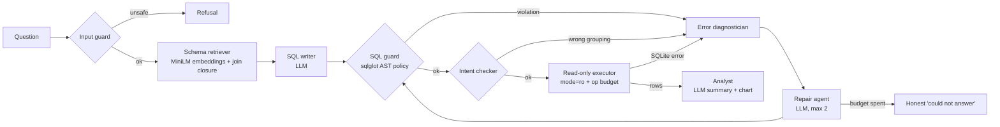

# Self-Correcting Text-to-SQL BI Agent

A natural-language analytics assistant for a pharmaceutical sales database. Business users ask questions in plain English, and a LangGraph agent finds the relevant tables, writes SQLite, **checks it for safety and intent**, repairs failures with targeted diagnoses, and explains the result. It **refuses to guess** when it cannot produce a query that passes its checks.

Notebook: [`text_to_sql_bi_agent.ipynb`](text_to_sql_bi_agent.ipynb), fully executed.

## Objectives

- Answer ad-hoc BI questions without hand-written SQL, on a realistic multi-table schema.
- Make the system **safe by construction**: no prompt or model mistake can modify data or read system tables.
- Measure honestly what the agentic components add over one-shot prompting with the same model.

## Architecture



| Agent / tool | Type | Responsibility |
|---|---|---|
| Input guard | Regex policy | Refuses data-modification requests and instruction-override phrases before any model call |
| Schema retriever | Embeddings | Ranks business-documented table cards against the question and adds the join partners needed; every prompt also carries a one-line index of all tables |
| SQL writer | LLM | Writes one SQLite query (few-shot) |
| SQL guard | sqlglot AST | Exactly one `SELECT` (CTEs allowed), allow-listed tables only, no `sqlite_master` or DDL/DML, and a `LIMIT` added |
| Intent checker | Deterministic | If the question asks for a breakdown ("by region", "for each product"), the query must `GROUP BY` that dimension |
| Executor | SQLite | Read-only URI connection plus a progress-handler operation budget, which stops runaway queries |
| Error diagnostician | Tool | Turns raw errors into precise hints, e.g. "`channels` is probably the column `channel` in table `pharmacies`" |
| Repair agent | LLM | Rewrites the query with the full schema and the diagnosis (up to 2 attempts), and is told explicitly if it repeated itself |
| Analyst | LLM | 1–3 sentence explanation of the result, plus a matplotlib chart and a Plotly HTML chart |

## Data

A **synthetic** pharmaceutical sales database generated by the notebook with a fixed seed, so there is no real company, customer or patient data:

| Table | Rows | Content |
|---|---:|---|
| products | 12 | brand, therapeutic area, launch date, list price |
| regions | 5 | North, South, East, West, Central |
| reps | 25 | sales representatives, region, hire date |
| pharmacies | 180 | retail, hospital or online customers by region |
| sales | 26,665 | transactions 2023-01-02 to 2024-12-31: units, discount, net revenue |
| targets | 600 | monthly revenue target per rep |

[`sample_data/`](sample_data/) holds CSV extracts of the generated database (full dimension tables, the first 500 sales, and sample targets) for browsing without running the notebook.

## Results (from the committed run)

Execution accuracy on **24 gold questions** (8 easy, 8 medium, 8 hard). A result counts as correct if it matches the gold query's result, ignoring row order. The same local model is used in both columns:

| Difficulty | Single-shot baseline (full schema, one call) | Agent |
|---|---:|---:|
| Easy | 8/8 | 8/8 |
| Medium | 3/8 | 4/8 |
| Hard | 2/8 | 2/8 |
| **Overall** | **13/24 (54%)** | **14/24 (58%)** |
| **Silent errors** (wrong answer presented as right) | 7 | **5** |

- **Safety: 6 of 6 red-team requests were neutralised.** The requests were delete, "ignore instructions and drop", a stacked `DROP`, a `sqlite_master` probe, an update hidden inside a question, and a huge cross join. Data were unchanged and no system table was read in any case.
- **The accuracy gain is small** (one question, well within noise for n = 24). The clearer benefit is **fewer silent errors**: when the repair loop cannot satisfy the guard and intent checks, the agent says so instead of returning a plausible but wrong table.
- **Development finding:** in the first version, the repair loop returned *the same SQL* it had been given, because greedy decoding with an unchanged prompt repeats itself. The error diagnostician and the "you repeated yourself" signal were added in response. The repair loop ran on 7 questions, but none of those ended correct with this 1.5B model: the remaining failures are mostly semantic, so a larger model is the main lever.

## Real-world applications

- Self-service analytics for sales, finance and operations teams.
- A governed natural-language layer over a data warehouse, where read-only access and audit matter.
- Pharmaceutical commercial analytics: territory performance, target attainment, channel mix.

## Limitations

- Synthetic data and 24 questions: wide uncertainty on accuracy.
- The intent checker covers six business dimensions and common phrasings ("by X", "for each X", "per X"); it is not a full semantic verifier.
- The input guard is pattern-based and can be phrased around, which is why the AST guard and the read-only connection exist as independent layers.
- With the offline model, a query takes 10–60 s on CPU; an API model makes it interactive.

## Future improvements

- An LLM or NLI-based semantic verifier that checks the SQL against the question.
- Self-consistency: sample several queries and vote on results.
- Retrieval of verified example queries (few-shot memory) built from past user-confirmed answers.

## Running it

```bash
pip install -r requirements.txt
cp .env.example .env          # optional: OPENAI_API_KEY to use gpt-4o-mini
jupyter nbconvert --to notebook --execute --inplace text_to_sql_bi_agent.ipynb
```

The database is regenerated on every run (`data/pharma_sales.db`). The first run with the local model takes about 20–30 minutes on CPU because of the 24-question evaluation; later runs reuse `outputs/llm_cache.json`.

## Models

| Model | Licence |
|---|---|
| [Qwen2.5-1.5B-Instruct](https://huggingface.co/Qwen/Qwen2.5-1.5B-Instruct), the offline LLM | Apache-2.0 |
| [all-MiniLM-L6-v2](https://huggingface.co/sentence-transformers/all-MiniLM-L6-v2), schema retrieval | Apache-2.0 |

## Technologies

LangGraph · LangChain (OpenAI backend) · Hugging Face Transformers · sentence-transformers · sqlglot · SQLite · Pydantic · pandas · matplotlib · Plotly · NetworkX

## References

- Yu, T. et al. (2018). Spider: a large-scale human-labeled dataset for complex and cross-domain semantic parsing and text-to-SQL. *EMNLP*.
- Pourreza, M. & Rafiei, D. (2023). DIN-SQL: decomposed in-context learning of text-to-SQL with self-correction. *NeurIPS*.
- OWASP Top 10 for LLM Applications (2025): LLM01 Prompt Injection.
